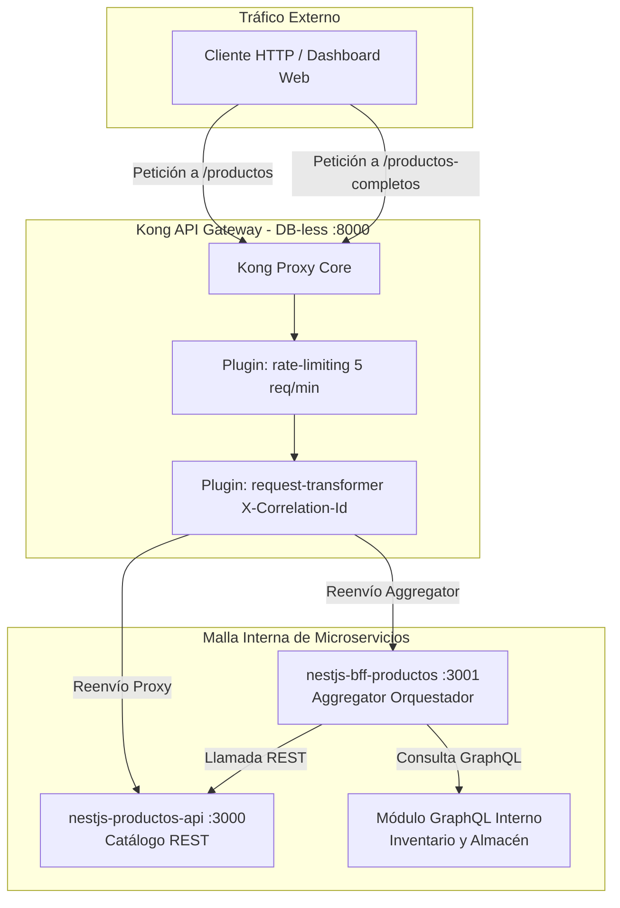

# Semana 8 · Kong Gateway DB-less, Rate Limiting y Patrón BFF/Aggregator REST + GraphQL


Repositorio de implementación integral para el taller de la **Semana 8: API Gateways y Service Mesh** de la asignatura **Integración de Sistemas** (6to Semestre).

---

## 🏛️ Arquitectura del Sistema

El ecosistema demuestra cómo centralizar responsabilidades transversales (*cross-cutting concerns*) en la frontera de red mediante un **API Gateway (North-South Traffic)** y componer fuentes de datos heterogéneas mediante el patrón **Backend-For-Frontend (BFF) / Aggregator**:



---

## 🚀 Componentes y Pasos del Taller

1. **Kong Gateway DB-less (Pasos 1 al 6):**
   * Configuración declarativa en `kong-gateway/kong.yml` sin base de datos relacional.
   * **Plugin `rate-limiting`:** Ventana local de 5 peticiones por minuto. La 6ª petición es rechazada de inmediato con código HTTP `429 Too Many Requests`.
   * **Plugin `request-transformer`:** Inyección y propagación automática de la cabecera `X-Correlation-Id`.
   * **Demostración de SPOF (Punto Único de Fallo):** Al detener Kong, el puerto 8000 deja de responder mientras los backends directos continúan operativos.
2. **Microservicio REST de Productos (`nestjs-productos-api` en puerto 3000):**
   * Catálogo de productos con captura y logueo explícito del header de trazabilidad.
3. **Microservicio BFF Aggregator (`nestjs-bff-productos` en puerto 3001):**
   * Endpoint orquestador `GET /productos-completos/:id` que combina la API REST y un resolver GraphQL de inventario en una única respuesta estructurada.
4. **Dashboard Web Interactivo (`/`):**
   * Consola visual con botones interactivos para probar proxy, ráfaga de rate-limiting (contador visual 1..5 y 429), trazabilidad distribuida y el Aggregator.
   * Guía oficial del taller embebida en `/workshop`.

---

## 🛠️ Ejecución Local

### Opción 1: Ejecución Unificada con Node.js
```bash
# 1. Instalar dependencias
npm install

# 2. Iniciar todos los microservicios y el simulador de Gateway
npm start
```
* Dashboard Web: [http://localhost:8000](http://localhost:8000)
* Guía del Taller: [http://localhost:8000/workshop](http://localhost:8000/workshop)
* Admin API Status: [http://localhost:8000/status](http://localhost:8000/status)

### Opción 2: Ejecución de Kong Gateway con Docker Compose
```bash
cd kong-gateway
docker compose up -d
```
* Proxy de Kong: `http://localhost:8000`
* Admin API de Kong: `http://localhost:8001`

---

## 🧪 Pruebas Automatizadas

```bash
# Ejecutar suite de pruebas con Jest
npm test

# Ejecutar verificación interactiva de Rate Limiting (disparo de 429)
npm run test:rate-limit
```

---

## 📂 Documentos Entregables

* 📖 **Bitácora Técnica y de Evidencias:** [`docs/bitacora-semana-8.md`](docs/bitacora-semana-8.md) (Respuestas a todas las preguntas de la guía, evidencias del 429, logs de trazabilidad y comparativa de overhead).
* 🛡️ **Informe Ejecutivo de Auditoría Empresarial:** [`docs/auditoria-empresarial-kong-gateway.md`](docs/auditoria-empresarial-kong-gateway.md) (Auditoría técnica con redacción en párrafos de tamaño mediano y mínimo código).
